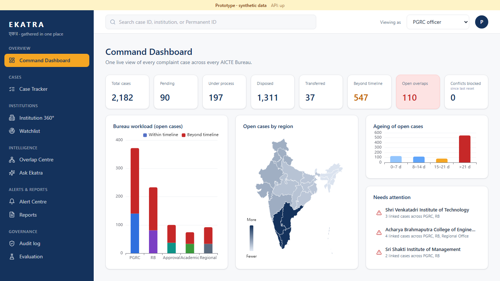
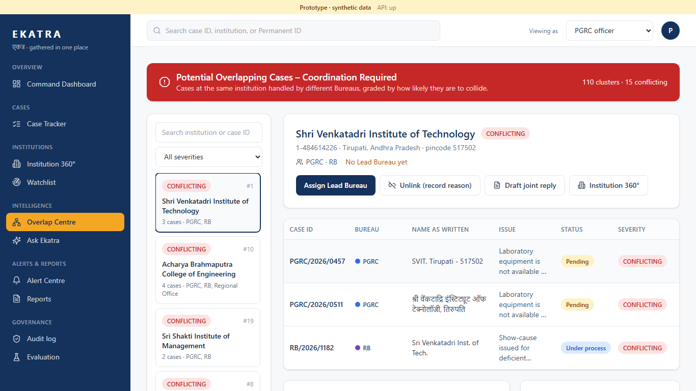
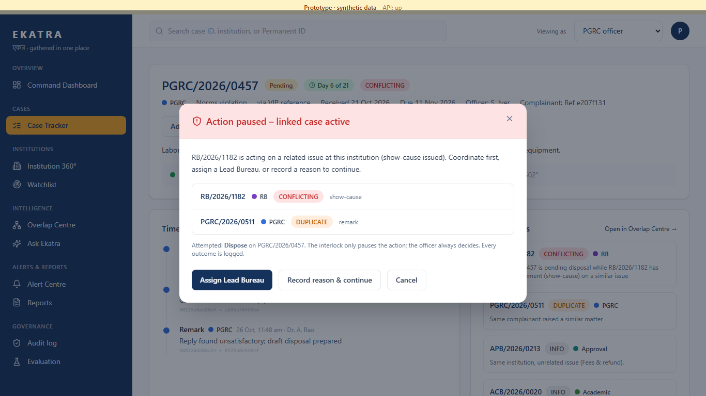
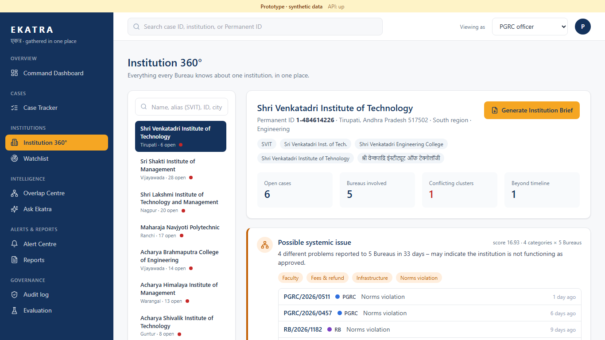
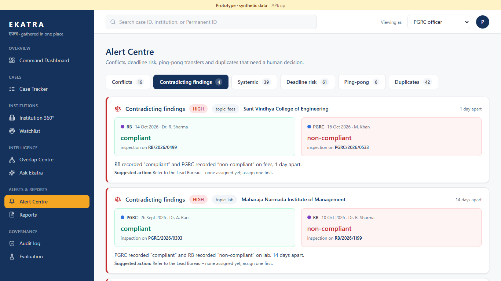
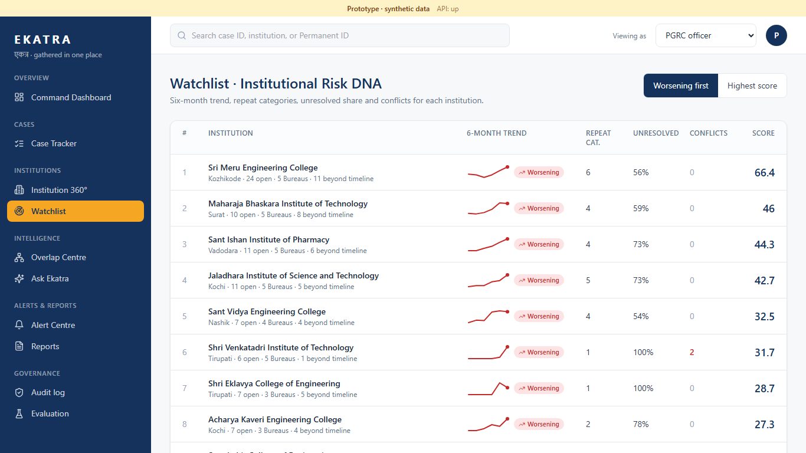
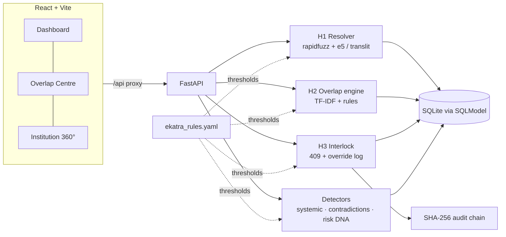

---
title: Ekatra – SIH26264
emoji: 🏛️
colorFrom: blue
colorTo: indigo
sdk: docker
app_port: 7860
pinned: false
short_description: Prototype (synthetic data) – Team Innovex_007
---

# Ekatra · एकत्र

**SIH26264 – Integrated Dashboard for Monitoring and Tracking Institution-Related Complaint Cases Across AICTE Bureaus/Cells**

> Two AICTE Bureaus never work blind on the same institution again. Ekatra finds the overlap even when institution names don't match, explains why, and pauses the conflicting action before it happens.

**Prototype · synthetic data.** Every institution, complainant and officer here is fictional. Nothing leaves your machine and no cloud AI is used.

| | |
|---|---|
|  |  |
|  |  |
|  |  |

## Demo video

> 🎥 **Demo video: _link to be added_** (placeholder: `https://youtu.be/XXXXXXXXXXX`)

## What it does

1. **Finds the same college under different names** (English, abbreviations, Devanagari) and links its cases across Bureaus, with a "Why linked?" card for every automatic link.
2. **Classifies overlaps** as CONFLICTING, DUPLICATE, RELATED or INFO and groups them into clusters under the banner "Potential Overlapping Cases – Coordination Required".
3. **Pauses conflicting actions** (interlock) before a Bureau disposes a case that contradicts another Bureau's active enforcement. The officer can always record a reason and continue; every override is logged in a tamper-evident audit chain.
4. **Surfaces patterns:** systemic issues across Bureaus, contradicting findings, and a Risk DNA watchlist.

## Tech stack

React 18 + Vite + TypeScript + Tailwind + Apache ECharts (frontend) · FastAPI + Pydantic + SQLModel + SQLite (backend) · rapidfuzz, scikit-learn TF-IDF, optional multilingual-e5-small (matching) · reportlab (PDFs) · Playwright (tests). Details in the table under [Architecture](#architecture).

## Run it on Windows

Run backend and frontend manually (what `.\dev.ps1` does for you):

```powershell
# one-time
.\setup.ps1
.\seed.ps1

# terminal 1 – backend API on http://localhost:8010
cd backend
.\.venv\Scripts\python.exe -m uvicorn app.main:app --host localhost --port 8010

# terminal 2 – frontend UI on http://localhost:5174
cd frontend
npm run dev
```

Or all at once:

Needs Python 3.13 and Node 20+ (tested with 3.13 and Node 24).

```powershell
.\setup.ps1         # once: venv + backend packages + frontend packages   (add -Tests for Playwright + Chromium)
.\seed.ps1          # 80 institutions + 2,000 cases (+182 planted for the finalist features); prints the demo-case table
.\dev.ps1           # starts the API and the UI in two windows
# open  http://localhost:5174
.\reset_demo.ps1    # back to the clean demo state in a few seconds (no re-seed), even while the app is running
.\stop.ps1          # frees the ports
```

- **Ports:** UI **5174**, API **8010** (not Vite's 5173 / 8000, which other local projects often use). Change them in `frontend/vite.config.ts` and `dev.ps1`. `dev.ps1` refuses to start on a busy port, because Windows lets two servers bind the same port and the older one keeps answering.
- `reset_demo.ps1` restores `data/ekatra.clean.db`, a snapshot the seed writes. It undoes dispose/override actions, lead assignments, unlinks, confirmed links, new cases, audit entries and the interlock mode.
- Optional Hindi embeddings: `backend\.venv\Scripts\python.exe -m pip install sentence-transformers` (downloads multilingual-e5-small once). Without it Ekatra falls back to transliteration + phonetic matching and everything still works.
- Evaluation: `backend\.venv\Scripts\python.exe eval\evaluate.py` (writes `eval/results.json`, shown on the Evaluation page).
- Linux/Mac: a `Makefile` exists but is **not tested**.

## Features: built vs roadmap

| # | Feature | Status |
|---|---|---|
| 1 | **Same-college resolver (H1):** normalise, fuzzy matching, acronym, pincode/city, multilingual embedding → auto-link ≥ 0.90, officer confirms 0.60–0.89 (alias is learned) | Built |
| 2 | **"Why linked?"** card on every automatic link (each factor, weight, confidence, decision) | Built |
| 3 | **Overlap severity (H2):** CONFLICTING / DUPLICATE / RELATED / INFO, clusters, Overlap Centre, joint-reply draft, unlink with reason | Built |
| 4 | **Conflict interlock (H3):** pauses dispose / show-cause; Assign Lead Bureau, record a reason, or cancel; block or warn-only mode | Built |
| 5 | **Hash-chained audit** of every action and override, plus a per-case timeline chain, with "Verify integrity" | Built |
| 6 | **Hidden Connection Detective:** ≥ 3 categories across ≥ 2 Bureaus in 90 days → "Possible systemic issue" | Built |
| 7 | **Contradiction Detective:** opposite verdicts from two Bureaus on the same institution and topic within 60 days | Built |
| 8 | **Institutional Risk DNA:** 6-month trend, repeat categories, unresolved share, conflicts, sparklines (Watchlist) | Built |
| 9 | Dashboard, Case Tracker, Case detail, Institution 360°, SLA risk, ping-pong detector, Alert Centre, Ask Ekatra (rule-based, English + basic Hindi), Reports (CSV/PDF/monthly pack), Institution Brief PDF | Built |
| 10 | Complainant identity masked for other Bureaus | Built |
| – | Mic input for Ask Ekatra (browser Web Speech API) | Built, **untested** (needs Chrome/Edge and a microphone) |
| – | PostgreSQL (`DATABASE_URL` is read; only SQLite was tested) | Roadmap |
| – | Scheduled SLA sweeps and email/SMS notifications (SLA is computed on read) | Roadmap |
| – | Real authentication / SSO (roles are a demo switcher) | Roadmap |
| – | Live CPGRAMS / bureau-system integration | Roadmap |

## Architecture



| Tool | Why (3 words) |
|---|---|
| React + Vite + TypeScript | fast typed UI |
| Tailwind CSS | consistent design tokens |
| Apache ECharts | charts and map |
| FastAPI + Pydantic | typed Python API |
| SQLModel + SQLite | zero-setup storage |
| rapidfuzz + trigram | explainable name matching |
| multilingual-e5-small | optional Hindi embeddings |
| indic-transliteration | Devanagari to Roman |
| scikit-learn TF-IDF | explainable issue similarity |
| reportlab | PDF briefs and reports |
| Playwright | screenshots and demo tests |

## Evaluation (synthetic data, seed 42)

`eval/evaluate.py` compares Ekatra with `data/answer_key.json`. The database holds **2,182 cases**: the original 2,000 plus 182 planted on 18 extra institutions for the finalist features. The first block is measured on the original 2,000 and is unchanged by the additions. Name matching used **multilingual-e5-small**.

| Metric | Result |
|---|---|
| Resolver precision (auto-links): all / messy names / Hindi script | **100% / 100% / 100%** |
| Resolver recall (auto-linked): all / messy / Hindi script | **89.5% / 80.9% / 77.9%** (207 more wait for one-click confirmation) |
| False links (auto-linked to the wrong institution) | **0 per 1,000** |
| True cross-Bureau overlapping pairs found vs exact Permanent-ID matching | **3,096 vs 477 → 6.5× more** |
| Severity accuracy on 56 planted pairs: classifier / end to end | **100% / 85.7%** (the misses are cases not auto-linked) |
| Conflicts blocked on planted conflicting actions | **15 / 16**, 0 false triggers on 200 control cases |
| Dashboard API p95 latency (2,182 cases) | **~37 ms** |
| Institution 360° built by the API | **~23 ms** median |
| Systemic issues found / decoys flagged | **5 / 5 · 0 / 5** |
| Contradictions found / controls flagged | **4 / 6** (both misses involve an unlinked case) **· 0 / 8** |
| Risk DNA trend correct (worsening / improving / stable) | **3/3 · 3/3 · 2/2** |

UI tests (Playwright, `.\setup.ps1 -Tests` first): `scripts/clickpath.mjs` follows the 2-minute demo path, 13 of 13 checks pass; `scripts/test_reports.mjs` confirms the CSV, PDF and monthly-pack downloads are non-empty, all pass; `scripts/audit_pages.mjs` visits every page and tab looking for console errors, empty states and blank charts.

Without e5 (`USE_E5=off`): recall 88.9% / 79.3% / 77.9%, 6.4×, 14 / 16 blocked. On this data e5 helps only marginally.

**Read these numbers with care.** The data and the planted pairs were produced by the same team that wrote the matcher, so results are almost certainly optimistic compared with real AICTE data. 34 other heavily-complained institutions also satisfy the systemic rule; they are not labelled in the synthetic data, so they are not counted as false alarms. The Risk DNA trend rule includes a noise margin that I added after the first version flagged 26 of 80 ordinary institutions as "worsening" (it now flags 6). There is no manual stopwatch baseline yet for "time to a full institution picture".

## Design choices worth knowing

- **Exact-name floor.** With the spec formula (0.45·name + 0.15·acronym + 0.15·location + 0.25·embedding) a clean name with no city or pincode tops out at 0.85, below the 0.90 auto-link line, so an exact, unique known name or alias is floored at 0.92 and the card says so. A best match must also beat the runner-up by 0.04 (two look-alike institutions share the acronym "SVIT").
- INFO pairs are derived, not stored; clusters form only from RELATED-or-stronger links. Same-Bureau pairs only count as DUPLICATE.
- "Conflicts blocked" on the dashboard counts interlock events, so it is 0 on a fresh seed.
- All thresholds live in `backend/app/rules/ekatra_rules.yaml`.

## Safeguards

Officer decides (continue-with-reason is always possible) · every override, lead assignment, unlink and link confirmation is logged · complainant identity masked for other Bureaus · SHA-256 hash chain over audit events and each case's actions · synthetic data only · runs on CPU with no cloud AI.

## The 2-minute demo

Start from `.\reset_demo.ps1`, then open http://localhost:5174.

| Time | Clicks | Say |
|---|---|---|
| 0:00 | **Command Dashboard** (opens by default). Point at the 8 tiles, the red **Open overlaps 110**, the workload chart and the map. | One live view of every Bureau's cases. |
| 0:15 | Under **Needs attention**, click **Shri Venkatadri Institute of Technology**. | Ekatra opens its newest conflict. |
| 0:20 | **Overlap Centre** (SVIT cluster is selected). Read the red banner and the 3 rows: *SVIT, Tirupati - 517502* · the Devanagari spelling · *Sri Venkatadri Inst. of Tech.* Scroll down to **Why linked?** (name, acronym, pincode 517502, confidence 1.00). Click the 3rd row (RB/2026/1182) to show the 0.92 exact-alias note. | Three spellings, one college, and every link explains itself. |
| 1:00 | Click **PGRC/2026/0457** → **Dispose** → **Confirm Dispose**. The red **Action paused – linked case active** modal appears; click **Assign Lead Bureau** → **Confirm Lead Bureau: RB**. | Disposal is paused before it contradicts RB's show-cause; the officer still decides. |
| 1:25 | Click the institution name on the case page → **Institution 360°**: Hindi alias, **Possible systemic issue** card, cross-Bureau timeline. Click **Generate Institution Brief** (PDF opens in a new tab). | Four different problems across five Bureaus: a pattern no single Bureau sees. |
| 1:45 | Sidebar **Audit log** → **Verify integrity** → "Chain intact – N events". | Every override is tamper-evident. |
| 1:52 | Sidebar **Alert Centre** → **Contradicting findings**; then **Evaluation**. | Bureaus contradicting each other, and the measured numbers. |
| 2:00 | Done. Run `.\reset_demo.ps1` before the next take. | |

## Repository

`backend/app` API and logic · `backend/app/rules/ekatra_rules.yaml` thresholds · `data/generator` synthetic data · `data/answer_key.json` ground truth · `eval/` evaluation · `frontend/` UI · `scripts/` Playwright tests (`demo.mjs` interlock click-through, `audit_pages.mjs` every page/tab, `test_reports.mjs` exports, `screenshots.mjs`, `v2shots.mjs`) and `reset_demo.py`.

Source size without ignored files (`node_modules`, `.venv`, `__pycache__`, `*.db`, `frontend/dist`, `*-1920.png`): **about 3.1 MB in 94 files**.

